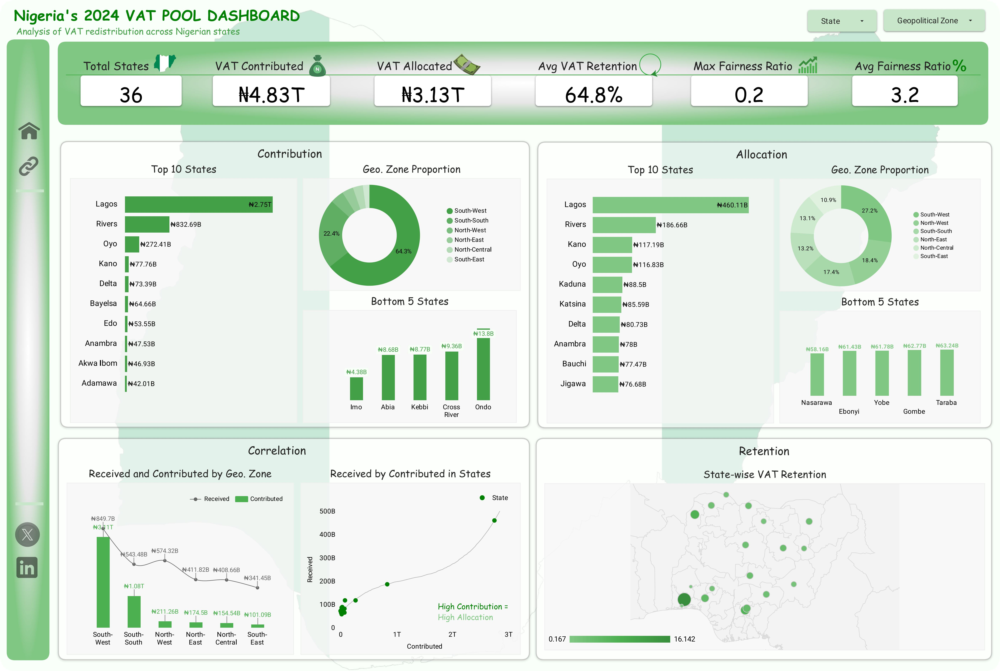

# Nigeria's 2024 VAT Pool: Contribution & Allocation Analysis

**Analyzing VAT contributions, allocations, retention, and distribution across Nigerian states and geopolitical zones.**

An interactive analysis of Nigeria's 2024 VAT pool, examining state contributions, allocations, VAT retention, geopolitical distribution, and the relationship between what states contribute and receive.

| | |
|---|---|
| **Field** | Economic Analytics |
| **Period** | 2025 |
| **Tools** | Microsoft Excel, Looker Studio |
| **Full case study** | [temidayokukoyi.vercel.app/work/nigeria-2024-vat-pool-analysis](https://temidayokukoyi.vercel.app/work/nigeria-2024-vat-pool-analysis) |

## The question

How was VAT distributed across Nigerian states in 2024, and how did state contributions compare with the amounts allocated back to them?

## Objective

The objective was to transform state-level VAT figures into an interactive dashboard that makes it easier to compare contributions and allocations, identify geographic patterns, and examine how much VAT states retained relative to the amounts they contributed.

## Context

Nigeria's VAT system generates revenue from economic activity across different states, while the resulting pool is distributed through an allocation process. This project explores the relationship between VAT contribution and allocation across Nigerian states, with a particular focus on geographic differences, retention, and distribution patterns.

## The data

State-level VAT contribution and allocation data covering Nigeria's states for 2024. The analysis focuses on contributed VAT, allocated VAT, VAT retention, and geographic distribution.

## Data sources

2024 Nigerian VAT allocation data used for the original analysis.

## Method

State-level aggregation and comparative analysis of VAT contributions and allocations, followed by geographic analysis across Nigeria's geopolitical zones. The results were presented through an interactive Looker Studio dashboard with state and geopolitical-zone filters.

## Analysis process

The analysis compared VAT contributed and VAT allocated at both state and geopolitical-zone levels. Key metrics were calculated to examine total contributions, allocations, average retention, maximum fairness ratio, and the relationship between contributions and allocations.

The dashboard was structured into four analytical areas: contribution, allocation, correlation, and retention. State-level rankings, geopolitical-zone distributions, contribution-versus-allocation relationships, and geographic retention patterns were then visualized to make differences easier to identify.

## What the data showed

### ₦4.83T — Total VAT contribution reached ₦4.83 trillion

The dashboard shows total VAT contributions of approximately ₦4.83 trillion across the 36 states included in the analysis. Contribution was highly concentrated geographically, with the South West accounting for the largest share of the VAT contributed.

### 64.8% — Average VAT retention stood at 64.8%

The dashboard reports an average VAT retention rate of 64.8%, providing an overall view of the proportion of contributed VAT retained across the states analyzed. The state-level retention view shows substantial variation between states, indicating that the overall average masks differences at the individual-state level

### ₦2.75T — Lagos dominated VAT contributions

Lagos contributed approximately ₦2.75 trillion, making it by far the largest contributor among the states displayed in the dashboard Lagos's contribution was substantially higher than Rivers, the second-highest contributor at approximately ₦832.69 billion.

### 64.3% — The South West generated the largest share of VAT contributions

The South West accounted for approximately 64.3% of the VAT contribution shown in the geopolitical-zone analysis, substantially exceeding the contribution share of the other zones. The concentration was strongly influenced by Lagos, whose contribution alone represented the largest state-level figure in the analysis.

### ₦3.13T — ₦3.13 trillion was allocated across the states

The dashboard records approximately ₦3.13 trillion in total VAT allocations, compared with ₦4.83 trillion in total contributions. The allocation analysis shows that the geographic pattern differed from the contribution pattern, with the South West receiving approximately 27.2% of the allocation compared with its much larger contribution share.

### ₦460.11B — Lagos received the largest state-level allocation

Lagos received approximately ₦460.11 billion, the largest allocation among the states displayed in the dashboard. Rivers followed with approximately ₦186.66 billion, while Kano and Oyo received approximately ₦117.19 billion and ₦116.83 billion respectively.

## Challenges

The main challenge was presenting a large amount of financial information in a way that could be understood quickly without losing the differences between contribution and allocation. I addressed this by separating the dashboard into contribution, allocation, correlation, and retention views and using state and geopolitical-zone filters for exploration.

## Recommendations

1. Monitor contribution and allocation separately when evaluating state-level VAT performance, as high contribution does not necessarily translate into an equivalent share of allocation.
2. Use state-level retention metrics alongside aggregate figures to identify differences that can be hidden by national or geopolitical averages.
3. Track geopolitical concentration over time to determine whether the observed distribution patterns remain consistent across different years.
4.Maintain consistent state-level VAT data structures so that future analyses can compare contribution, allocation, and retention across multiple years.
5. Use contribution-versus-allocation analysis as a starting point for deeper investigation, particularly for states with large differences between their contribution and allocation figures.

## Outcome

**What came out of it**
An interactive Looker Studio dashboard comparing what each Nigerian state contributed to the 2024 VAT pool with what was allocated back to it, including retention rates and a geopolitical-zone view.

**What it showed**
Contributions of about ₦4.83 trillion against allocations of about ₦3.13 trillion. Lagos alone contributed about ₦2.75 trillion and received the largest allocation, about ₦460.11 billion. The South West generated about 64.3% of contributions while allocations were spread more evenly across zones. Average retention stood at 64.8%.

**What it supports**
A reader can separate contribution from allocation for any state, the distinction the public debate on VAT sharing usually blurs, and see which states have the widest gap between the two.

**Status**
An independent analysis of published 2024 VAT allocation data; not commissioned. The natural next step is a multi-year version to show whether the concentration is changing.

## In this repository

- `figures/` — 1 dashboard and report screenshot.
- [View Interactive VAT Dashboard](https://datastudio.google.com/s/qeWNFBSQrds)

## Skills applied

Data Analysis, Data Visualization, Dashboard Design, KPI Development, Financial Analysis, Geographic Analysis, Exploratory Data Analysis, Looker Studio

---

**Temidayo Kukoyi** · Data analyst · [temidayokukoyi.vercel.app](https://temidayokukoyi.vercel.app) · [LinkedIn](https://www.linkedin.com/in/temidayo-kukoyi-5a59a7353)
